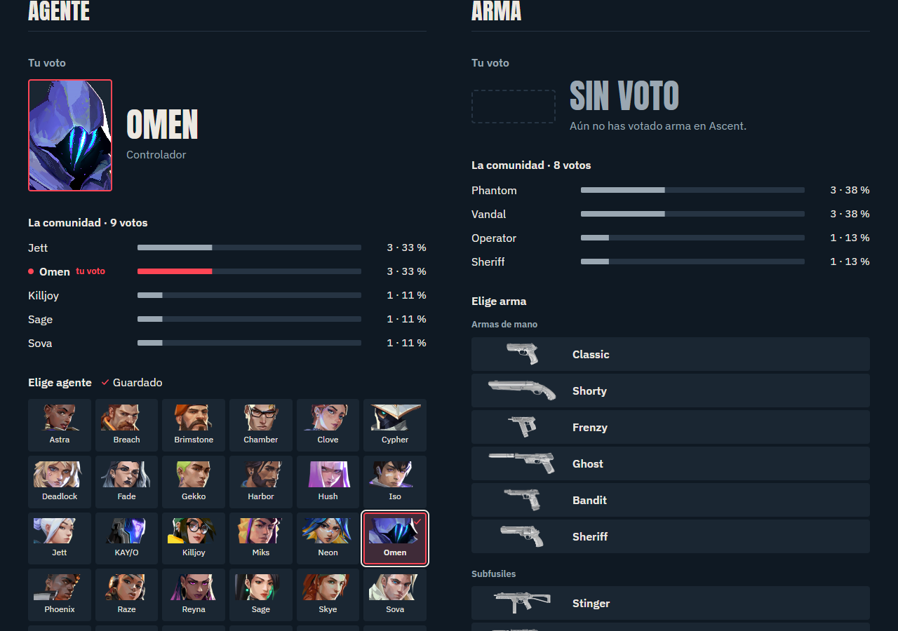
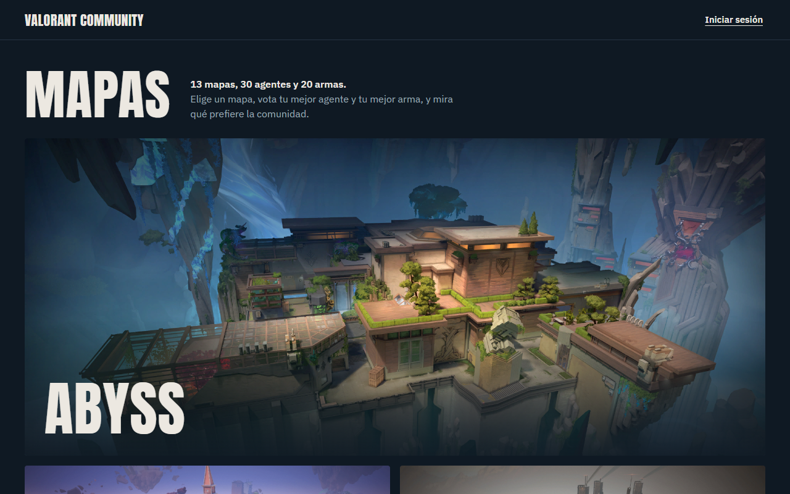
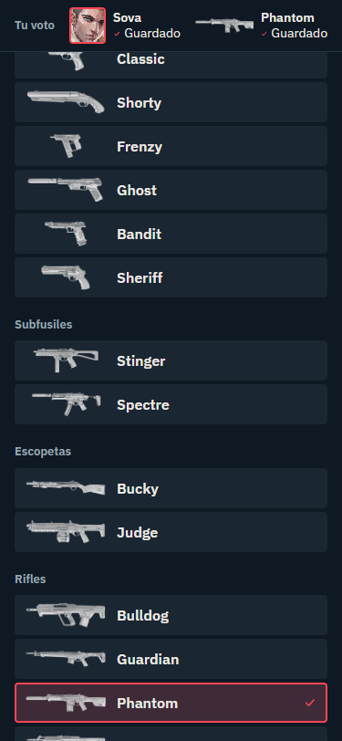

# Valorant Community

Aplicación web para que la comunidad de VALORANT vote, en cada mapa competitivo, **el mejor agente y la mejor arma**, y vea cómo se reparten los votos.

Prueba técnica full stack para Lucidbot: monorepo con **NestJS** (API) y **React + Vite** (web), **PostgreSQL**, **Docker Compose** y datos reales del juego de [Valorant API](https://valorant-api.com/).



## Inicio rápido

Solo necesitas **Docker** (Docker Desktop en Windows y macOS) y conexión a internet.

```bash
git clone https://github.com/yhonaMC/valorant-community.git
cd valorant-community
cp .env.example .env          # en PowerShell o cmd: copy .env.example .env
docker compose up --build --wait
```

Abre **<http://localhost:8080>**.

- `--wait` devuelve el control cuando la base de datos, la API y la web están sanas. Las migraciones se aplican solas al arrancar.
- No hay usuarios precargados: pulsa **«Crear cuenta»** y usa un email con un dominio real (por ejemplo `@gmail.com`); la contraseña debe tener entre 8 y 72 caracteres.
- Para parar: `docker compose down`. Para borrar también los datos: `docker compose down -v`.

### Recorrido sugerido (2 minutos)

1. En la portada, elige un mapa. Sin sesión ya ves los resultados.
2. Pulsa un agente: te lleva a crear una cuenta y luego te devuelve a ese mapa.
3. Vota un agente y un arma; los recuentos y las barras se actualizan con la respuesta del servidor.
4. Vuelve a pulsar el mismo agente: no suma. Elige otro: el voto se mueve del anterior al nuevo y el arma no cambia.
5. Recarga la página o reinicia los contenedores: tu elección se conserva.

## Qué hace

| | |
|---|---|
| **Explorar** | Los 13 mapas de la rotación competitiva, con su arte, y una página de detalle por mapa. |
| **Votar** | Con sesión: un agente y un arma por mapa, modificables por separado. Repetir el voto no suma; cambiarlo lo mueve. |
| **Resultados** | Barras horizontales con conteo y porcentaje, y un total independiente para agentes y armas. Tu opción siempre aparece, aunque no esté entre las cinco primeras. |
| **Cuentas** | Registro e inicio de sesión con email y contraseña. El email debe tener un formato válido y un dominio que reciba correo (registro MX). |
| **Errores** | Si un voto no se guarda, el aviso dice qué voto sigue registrado y ofrece Reintentar. Si Valorant API cae, se sigue sirviendo la última copia del catálogo. |
| **Accesibilidad** | Selección con teclado, foco visible, anuncios para lectores de pantalla y respeto a «reducir movimiento». Funciona desde 360 px de ancho. |

<table>
  <tr>
    <td width="60%"></td>
    <td></td>
  </tr>
</table>

Más capturas en [docs/capturas/](docs/capturas/): acceso con errores, error al guardar, tu fila fuera del top 5 y la página completa en móvil.

## Stack

| Capa | Tecnología |
|---|---|
| API | NestJS 11, Prisma 6, PostgreSQL 16, class-validator |
| Web | React 19, Vite 7, React Router 7, TanStack Query 5, CSS Modules |
| Sesión | JWT en cookie `HttpOnly` + `SameSite=Lax`, contraseñas con `scrypt` |
| Infraestructura | Docker Compose (db, api, web con nginx), monorepo pnpm |
| Pruebas | Jest + supertest (e2e contra PostgreSQL real) |

nginx sirve la web y reenvía `/api` a la API, así que todo vive en el mismo origen: sin CORS y con la cookie funcionando igual en Docker y en desarrollo.

## API

| Método y ruta | Sesión | Descripción |
|---|---|---|
| `POST /api/auth/register` · `login` · `logout` | — | Crear cuenta, iniciar y cerrar sesión |
| `GET /api/auth/me` | sí | Usuario actual |
| `GET /api/catalog` | — | Mapas, agentes y armas (recortados de Valorant API) |
| `GET /api/maps/:mapId/results` | opcional | Recuentos por categoría y, con sesión, tus votos |
| `PUT /api/maps/:mapId/votes/:category` | sí | Votar o cambiar el voto (`agent` o `weapon`) |

Códigos de respuesta, modelo de datos y decisiones de seguridad en [docs/ARCHITECTURE.md](docs/ARCHITECTURE.md).

## Variables de entorno

Todas están en `.env.example`, con valores válidos para ejecutar en local. No hay secretos reales en el repositorio.

| Variable | Uso |
|---|---|
| `POSTGRES_USER`, `POSTGRES_PASSWORD`, `POSTGRES_DB` | Credenciales y nombre de la base de datos del contenedor `db`. |
| `DB_PORT` | Puerto de PostgreSQL en tu máquina (solo `localhost`). Por defecto `5433`. |
| `DATABASE_URL` | Solo para ejecutar la API o las pruebas fuera de Docker. |
| `JWT_SECRET` | Firma de la cookie de sesión. **Cámbialo** por una cadena larga y aleatoria. La API no arranca sin él. |
| `APP_ORIGIN` | Orígenes desde los que se aceptan escrituras, separados por comas. La API no arranca sin él. |
| `COOKIE_SECURE` | `true` solo si la aplicación se sirve por HTTPS. |
| `WEB_PORT` | Puerto de la web en tu máquina. Por defecto `8080`. |

## Desarrollo y pruebas

Fuera de Docker hacen falta Node.js 22 o superior y pnpm 11.

```bash
pnpm install
docker compose up -d --wait db     # solo PostgreSQL
pnpm dev:api                       # API en http://localhost:3000
pnpm dev:web                       # web en http://localhost:5173 (proxy de /api a la API)
```

Pruebas e2e de la API (necesitan PostgreSQL en marcha):

```bash
pnpm test:api                      # 27 pruebas
```

Usan su propia base de datos (`valorant_test`), que crean y migran ellas mismas, y sustituyen Valorant API y el DNS por respuestas fijas: no tocan tus datos ni dependen de la red. Cubren:
- registro y login, incluido el rechazo de dominios de email sin correo;
- la cookie de sesión y la protección de escrituras (`Origin` y `Content-Type`);
- el voto repetido y 10 votos concurrentes, que dejan una sola fila;
- el cambio de voto sin tocar la otra categoría ni otros mapas;
- la agregación por mapa, los identificadores inválidos y la caída de Valorant API.

## Solución de problemas

| Síntoma | Causa y solución |
|---|---|
| `port is already allocated` | El puerto `8080` o `5433` está ocupado. Cambia `WEB_PORT` o `DB_PORT` en `.env`. |
| Registrarse o votar devuelve **403** | Abriste la app en una dirección que no está en `APP_ORIGIN` (por ejemplo `http://127.0.0.1:8080`, o cambiaste `WEB_PORT`). Añádela a `APP_ORIGIN` y ejecuta de nuevo `docker compose up -d`. |
| «No pudimos cargar los mapas de VALORANT…» | La API no pudo descargar el catálogo de Valorant API (sin internet o servicio caído). Pulsa Reintentar cuando vuelva la conexión. |
| «Ese dominio de correo no existe o no recibe emails» | El dominio del email no tiene servidor de correo. Usa un email real. |
| `Cannot connect to the Docker daemon` | Docker Desktop no está abierto. |

## Estructura

```
apps/
  api/    NestJS: auth/, catalog/, votes/; prisma/ con el esquema y las migraciones; test/ con las e2e
  web/    React + Vite: features/auth, features/maps, features/map-detail; nginx.conf para Docker
docs/     Arquitectura, uso de IA y capturas
PLAN.md   Plan de trabajo, decisiones y registro por hitos
```

## Uso de IA

Desarrollado con Claude Code y agentes con un reparto explícito: yo tomé las decisiones de producto, diseño y alcance, y validé cada hito; los agentes investigaron e implementaron tareas acotadas, con el contrato de la API fijado antes de trabajar en paralelo en `apps/api` y `apps/web`. La interfaz se revisó con Impeccable (`critique` y `audit`). Qué acepté, qué corregí y cómo lo validé está en [docs/AI.md](docs/AI.md); el registro por hito, en [PLAN.md](PLAN.md).

## Decisiones de alcance

- **Mapas:** solo los 13 de la rotación competitiva. Valorant API no los marca; se identifican porque son los únicos con `tacticalDescription`.
- **Armas:** 20, sin el arma cuerpo a cuerpo.
- **Votos:** no se puede retirar un voto, solo cambiarlo.
- **Resultados públicos:** cualquiera puede verlos; solo votar exige sesión.

## No implementado

- Revocación de sesiones en el servidor: cerrar sesión borra la cookie, pero un token copiado sigue siendo válido hasta que caduca (7 días).
- Límite de intentos de inicio de sesión.
- Verificación del email por correo: se comprueba el formato y que el dominio reciba correo, no que el buzón exista.
- Retirar un voto.
- Agrupar los agentes por rol en el selector.
- Conservar el agente que eligió un visitante después de iniciar sesión (vuelve al mapa, pero tiene que elegirlo de nuevo).
- Pruebas automáticas del frontend. La interfaz se recorrió en un navegador real (Chrome headless) en escritorio y móvil, con teclado, con un error del servidor simulado y con movimiento reducido; ver `PLAN.md`, hito H6.

## Límites conocidos

- En móvil, la cabecera de cada mapa descarga su arte a 1920×1080 (unos 2,2 MB): Valorant API no ofrece una versión intermedia con el mismo encuadre.
- Las coordenadas y «Sites A/B» se muestran tal como los entrega Valorant API.

## Nota

Proyecto no oficial, sin fines comerciales, hecho solo para una evaluación técnica. VALORANT y su arte pertenecen a Riot Games; las imágenes se cargan directamente desde Valorant API y no se incluyen en el repositorio, salvo en las capturas de `docs/capturas/`.
